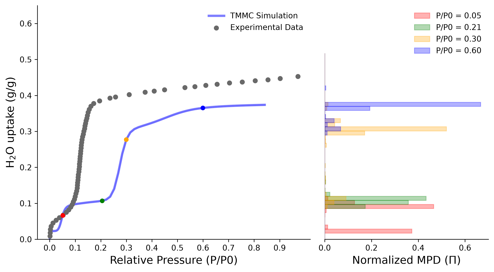

=========================
Hybrid TMMC/MD Simulation
=========================

Brief introduction about TMMC simulation
~~~~~~~~~~~~~~~~~~~~~~~~~~~~~~~~~~~~~~~~

The transition matrix Monte Carlo (TMMC) scheme is based on the determination of the system's transition probabilities going from one macrostate (referring to a fixed number of adsorbates inside the porous material) to another.
The change of the total energy for a virtual insertion and virtual deletion moves is recorded and used to construct the transition matrix (more details are given in the theoretical background) from which all ensemble properties can be derived.
The TMMC simulation needs to be run in combination with a Grand Canonical Monte Carlo (GCMC) or Molecular Dynamics (MD) simulation to propagate the system. The simulation follows five steps:

1. Initiate the system with a fixed number of adsorbates in the pore;
2. Equilibrate the system using MC moves, MD moves, or a combination of both;
3. Generate a set of equilibrated configurations;
4. Perform virtual insertions and deletions on the equilibrated configurations to construct the transition matrix.
5. Analyze the results to obtain the macrostate probability distribution (MPD) and all ensemble properties (adsorption isotherm).

----

Step 1. Initializing the simulation
~~~~~~~~~~~~~~~~~~~~~~~~~~~~~~~~~~~

In this example, we will investigate water adsorption in MOF-303, a promising candidate material for water harvesting due to its large water uptake at low relative pressures.
Specifically, the seeding molecules are stabilized by a slight reorientation of the ligands, allowing the water molecule to form strong hydrogen-bonds with the framework.

The MOF and adsorbate geometry can be found in ``flames/examples/Advanced/02-TMMC/MOF-303_symm.cif`` and ``flames/examples/Advanced/02-TMMC/H2O.xyz``, respectively.
For this example, we will use a basepoke MACE [1]_ machine learning potential is located at ``flames/examples/Advanced/02-TMMC/MOF-303_mace.model``.

.. warning:: In this example, we will only run a TMMC simulation for the macrostate of 5 molecules, to obtain the full picture every possible macrostates needs to be sufficiently covered.

.. code:: python

    import os
    import warnings

    import ase
    import torch
    from ase.data import vdw_radii
    from ase.io import read
    from mace.calculators import mace_mp

    from flames.tmmc import TMMC
    from flames.gcmc import GCMC
    from flames.adsorbate import Adsorbate

    warnings.filterwarnings("ignore", category=UserWarning)
    warnings.filterwarnings("ignore", category=RuntimeWarning)

    os.environ["KMP_DUPLICATE_LIB_OK"] = "TRUE" # Only required for windows users

    device = "cuda" if torch.cuda.is_available() else "cpu"

    model = MACECalculator(
        model_path="MOF-303_mace.model",
        device=device,
        default_dtype="float64"
        )

    FrameworkPath = "MOF-303_symm.cif"
    AdsorbatePath = "H2O.xyz"

    # Load the framework structure
    framework = read(FrameworkPath) 

    # Load the adsorbate structure
    adsorbate = Adsorbate(
        name="H2O",
        structure=read(AdsorbatePath),
        move_weights={
            "insertion": 0.0,
            "deletion": 0.0,
            "translation": 0.5,
            "rotation": 0.5,
            "reinsertion": 0.0
            },
        eos={
        "criticalTemperature": 647.096,
        "criticalPressure": 22064000.0,
        "acentricFactor": 0.3449
        }
    )

    NMolecules = 5
    ExternalTemperature = 298.0  # in Kelvin
    # The pressure below is used only for the MD steps, the pressures for generating the isotherm will be used later
    ExternalPressure = 100_000  # in Pa = 1 bar 

    outputFolder = f'results_{ExternalTemperature:.2f}_{ExternalPressure:.2f}_{NMolecules:03d}'

    gcmc = GCMC(
        model=model,
        framework_atoms=framework,
        adsorbates=adsorbate,
        temperature=ExternalTemperature,
        pressure=ExternalPressure,
        device=device,
        vdw_radii=vdw_radii,
        vdw_factor = 0.6,
        adsorbate_energy=-467.837350,
        max_deltaE = 1.555,
        save_frequency = 100,
        save_rejected = False,
        output_to_file = True,
        fugacity_coeff = 1.0,
        random_seed = None,
        cutoff_radius = 5.0,
        automatic_supercell = False,
        output_folder=outputFolder
        )

    gcmc.logger.print_header()

    gcmc.insert_adsorbates(ads_name=adsorbate.name, n_adsorbates=NMolecules, max_attempts=10000)

----

Breaking down the input script
~~~~~~~~~~~~~~~~~~~~~~~~~~~~~~
The first block of the code is similar to the one used in the Widom insertion tutorial, where we import the necessary libraries, set up the device, load the model and read the framework and adsorbate structures.

Initializing the simulator
--------------------------

.. code:: python

    NMolecules = 5
    ExternalTemperature = 298.0  # in Kelvin
    # The pressure below is used only for the MD steps, the pressures for generating the isotherm will be used later
    ExternalPressure = 100_000  # in Pa = 1 bar 

    outputFolder = f'results_{ExternalTemperature:.2f}_{ExternalPressure:.2f}_{NMolecules:03d}'

    gcmc = GCMC(
        model=model,
        framework_atoms=framework,
        adsorbates=adsorbate,
        temperature=ExternalTemperature,
        pressure=ExternalPressure,
        device=device,
        vdw_radii=vdw_radii,
        vdw_factor = 0.6,
        adsorbate_energy=-467.837350,
        max_deltaE = 1.555,
        save_frequency = 100,
        save_rejected = False,
        output_to_file = True,
        fugacity_coeff = 1.0,
        random_seed = None,
        cutoff_radius = 5.0,
        automatic_supercell = False,
        output_folder=outputFolder
        )

    gcmc.logger.print_header()

    gcmc.insert_adsorbates(ads_name=adsorbate.name, n_adsorbates=NMolecules, max_attempts=10000)

Here, we are starting the system with 5 water molecules ramdonly inserted in the MOF-303 framework. At this point, we also add the DFT energy of a single water molecule (``-467.837350``) to the input since the used model was not trained on single molecules or the bulk water phase.

2. Equilibrating the system
~~~~~~~~~~~~~~~~~~~~~~~~~~~

.. code:: python

    MDSteps = 1000
    MCSteps = 1000

    for i in range(5):
    gcmc.run(MCSteps)

    gcmc.md(
        nsteps=MDSteps,
        time_step=0.5,
        ensemble="NPT",
        thermostat="MTK",
        movie_interval=100
    )

Here we will run cycles of MC steps followed by MD steps to equilibrate the system. The number of MC and MD steps can be adjusted based on the system and the desired level of equilibration.
We will run 10 cycles of 5000 MC steps followed by 5000 MD steps, which should be sufficient to equilibrate the system. The MD simulation is run in the NPT ensemble with a time step of 0.5 fs and a MTK thermostat.

3. Generating equilibrated configurations
~~~~~~~~~~~~~~~~~~~~~~~~~~~~~~~~~~~~~~~~~

.. code:: python

    md_traj = Trajectory(f"Trajectory_{NMolecules:04d}.traj", "w")

    gcmc.md(
        nsteps=1000,
        time_step=0.5,
        ensemble="NPT",
        thermostat="MTK",
        movie_interval=100,
        set_momenta=False,
        trajectory_file=md_traj
        )

Here we will generate the equilibrated configurations by running a longer MD simulation in the NPT ensemble. The trajectory will be saved to a file for later analysis.
We are saving the trajectory to a file named ``Trajectory_0005.traj`` for later analysis. The MD simulation is run for 1000 steps with a time step of 0.5 fs and a MTK thermostat, saving 
the trajectory every 100 steps, generating a total of 10 frames to run the TMMC simulation on.
The momenta are not reset at the beginning of the simulation to maintain the system's dynamics from the previous equilibration step.

.. warning:: For production calculations, the system needs to be well equilibrated for the simulations to be accurate. The number of MC and MD steps should be adjusted with considerably higher values based on the system and the desired level of equilibration.

4. Running the TMMC simulation
~~~~~~~~~~~~~~~~~~~~~~~~~~~~~~

.. code:: python

    tmmc = TMMC(
        model,
        framework,
        adsorbate,
        temperature=ExternalTemperature,
        pressure=ExternalPressure,
        device=device,
        vdw_radii=vdw_radii,
        adsorbate_energy=-467.837350,
        vdw_factor=0.6,
        save_frequency=1,
        automatic_supercell=False,
        output_folder=outputFolder
    )

    tmmc.logger.print_header()

    tmmc.run_tmmc(100, f"Trajectory_{args.NMolecules:04d}.traj")

    tmmc.logger.print_summary()
    tmmc.save_results()

Here 100 virtual insertions and deletions will be performed on each of the 10 frames generated in the previous step, generating in total 1.000 evaluations per macrostate, and 45.000 in total.
This will allow the construction of the transition matrix and allowing to calculate the macrostate probability distribution (MPD) and all ensemble properties.

After this step, three new files will be created in the output folder: ``del_ernergy_0005.npy``, ``ins_ernergy_0005.npy``, and ``volume_0005.npy``, containing the deletion energies, insertion energies and volumes, respectively.

.. warning:: For the results analysis it is necessary to have data for all macrostates, which is not the case in this example. The following code snippet is only for demonstration purposes. For the MOF-303, it is necessary to run from N=0 to N=45 to obtain the full adsorption isotherm.

Each macrostate can be executed in parallel, allowing to speed up the calculations.

In case you plan to run them serially (if you only have access to one GPU), you can start the each new step from the results of the previous one to speed up the equilibration.
For example, you can start the N=6 macrostate from the final configuration of the N=5 macrostate, and so on:

.. code:: python

    PreviousN = 5
    gcmc.load_state(os.path.join(f'results_{ExternalTemperature:.2f}_{ExternalPressure:.2f}_{PreviousN:03d}', 'Movies', 'Trajectory.traj'))

In the example folder, there are two python scripts, ``run_tmmc_paralell.py`` and ``run_tmmc_serial.py``. In the second one, each point is started from the final configuration of the previous macrostate, while in the first one, each macrostate runs independently.

5. Analyzing the output
~~~~~~~~~~~~~~~~~~~~~~~

The stored values now allow to calculate the macrostate probability distribution (MPD), given access to all ensemble properties. Specifically, we can calculate the adsorption isotherm as follows.

.. code:: python

    import os
    import shutil
    from tqmd import tqdm
    import numpy as np
    import matplotlib.pyplot as plt
    from ase.io import read
    import numpy as np
    from ase.data import vdw_radii

    from flames.adsorbate import Adsorbate
    from flames.tmmc import TMMC
    from ase.calculators.singlepoint import SinglePointCalculator

    ads = Adsorbate(
        name='H2O',
        structure=read('H2O.xyz'),
        eos={
            "criticalTemperature": 647.096,
            "criticalPressure": 22064000,
            "acentricFactor": 0.3449,

        }
    )

    framework = read('MOF-303_symm.cif')

    # Create a dummy calculator to be able to use the TMMC class
    calc = SinglePointCalculator(
        atoms=framework,
        energy=0.0,
        forces=np.zeros((len(framework), 3)),
        stress=np.zeros((3, 3))
        )

    simulator = TMMC(
        model=calc,
        framework_atoms=framework,
        adsorbates=ads,
        temperature=298.0,
        device='cpu',
        pressure=1e5,
        vdw_radii=vdw_radii,
        vdw_factor=0.6,
        framework_energy=0.0,
        adsorbate_energy=0.0,
        automatic_supercell=False,
    )

    max_loading = 45

    os.makedirs('replica_1', exist_ok=True)

    for i in tqdm(range(0, max_loading + 1)):

        folder = f'results_298.00_100000.00_{i:03d}'

        os.makedirs(folder, exist_ok=True)
        shutil.copy(os.path.join(folder, f'del_energy_H2O_{i:04d}.npy'), f'replica_1/del_energy_H2O_{i:04d}.npy', )
        shutil.copy(os.path.join(folder, f'ins_energy_H2O_{i:04d}.npy'), f'replica_1/ins_energy_H2O_{i:04d}.npy')
        shutil.copy(os.path.join(folder, f'volume_{i:04d}.npy'), f'replica_1/volume_{i:04d}.npy')
    
    press_list = np.concatenate(
        [np.arange(1, 300, 10),
        np.arange(300, 5000, 50)]
        )

    fugacity = np.array([ads.eos.get_fugacity_coefficient(298.15, pressure_pa) * pressure_pa for pressure_pa in press_list])

    ins_w, del_w  = simulator.load_tmmc_weights(
        file_path='replica',
        max_loading=max_loading,
        replicas=range(1, 2),
        show_progress=True
    )

    uptake_list, uptake_sd, pi_list = simulator.compute_isotherm(
        fugacities_Pa=fugacity,
        uptake_units='nmol',
        show_progress=True
    )

    
    def plot_isotherm(
            fugacity: np.ndarray,
            uptake: np.ndarray,
            uptake_sd: np.ndarray,
            pi_list: np.ndarray,
            conversion_factor: float,
            max_loading: int,
            p_sat=3169,
            experimental_data_path=None,
            highlight_points=None) -> tuple:

        fig, ax = plt.subplots(1, 2, figsize=(9, 5), width_ratios=[2, 1.2], sharey=False)

        ax[0].plot(fugacity / p_sat, uptake * conversion_factor, '-', lw=3, label="TMMC Simulation", color="blue", alpha=0.5)

        ax[0].fill_between(fugacity / p_sat, (uptake - uptake_sd) * conversion_factor, (uptake + uptake_sd) * conversion_factor, color="blue", alpha=0.2)

        #ax[0].errorbar(fugacity / p_sat, uptake, yerr=uptake_sd, fmt='o', ecolor='blue', color='blue', label="TMMC Adsorption", alpha=0.5, capsize=2, markersize=3)

        if experimental_data_path is not None:
            exp_data = np.genfromtxt(experimental_data_path, delimiter=",").T
            ax[0].scatter(exp_data[0], exp_data[1], color="dimgrey", s=30, label="Experimental Data", zorder=10)

        ax[0].set_xlabel("Relative Pressure (P/P0)", fontsize=14)
        ax[0].set_ylabel("H$_2$O uptake (g/g)", fontsize=14)

        color_list = ["red", "green", "orange", "blue"]

        if highlight_points is not None:
            # Find the index that is closer to the specified highlight points
            points_position = [np.argmin(np.abs(fugacity / p_sat - point)) for point in highlight_points]

            for i, point in enumerate(points_position):
                ax[0].plot(fugacity[point] / p_sat, uptake[point] * conversion_factor, 'o', color=color_list[i], markersize=5, zorder=10)

            for i, point in enumerate(points_position):
                    ax[1].barh(
                        np.array(range(0, (max_loading))) * conversion_factor, pi_list[point],
                        label=f"P/P0 = {fugacity[point] / p_sat:.2f}",
                        color=color_list[i],
                        alpha=0.3, height=conversion_factor, edgecolor=color_list[i]
                        )

        ax[0].set_ylim(0, 0.65)

        ax[0].legend(framealpha=0, fontsize=10)    

        ax[1].set_ylim(0, 0.65)
        #ax[1].set_xlim(0, 0.3)

        ax[1].legend(framealpha=0)

        ax[1].set_xlabel(r"Normalized MPD ($\Pi$)", fontsize=14)

        # Remove the top and right spines from both subplots
        for a in ax:
            a.spines['top'].set_visible(False)
            a.spines['right'].set_visible(False)

        ax[1].spines['left'].set_visible(False)

        # Turn off scientific notation for the x-axis of the second subplot
        ax[0].ticklabel_format(style='plain', axis='y')

        # Remove left ticks and labels from the second subplot
        ax[1].tick_params(axis='y', which='both', left=False, labelleft=False)

        ax[0].set_xticks(np.arange(0, 1.0, 0.1))

        plt.tight_layout()

        return fig, ax

    fig, ax = plot_isotherm(
        fugacity=fugacity,
        uptake=uptake_list,
        uptake_sd=uptake_sd,
        conversion_factor=simulator.conv_factors['mg/g']['H2O'] * 1e-3,
        pi_list=pi_list,
        max_loading=max_loading,
        p_sat=3169,
        experimental_data_path="MOF-303_298K_exp.csv",
        highlight_points=[0.05, 0.2, 0.3, 0.6]
    )

    plt.show()

Breaking down the input script
~~~~~~~~~~~~~~~~~~~~~~~~~~~~~~

.. code:: python

    # Create a dummy calculator to be able to use the TMMC class
    calc = SinglePointCalculator(
        atoms=framework,
        energy=0.0,
        forces=np.zeros((len(framework), 3)),
        stress=np.zeros((3, 3))
        )

    simulator = TMMC(
        model=calc,
        framework_atoms=framework,
        adsorbates=ads,
        temperature=298.0,
        device='cpu',
        pressure=1e5,
        vdw_radii=vdw_radii,
        framework_energy=0.0,
        adsorbate_energy=0.0,
        automatic_supercell=False,
    )

This first block of the script is used to create a dummy calculator to be able to use the TMMC class.
The TMMC class requires a calculator to be passed as an argument, but since we are only interested in analyzing the results, we can use a dummy calculator that does not perform any calculations.

.. code:: python

    max_loading = 45

    os.makedirs('replica_1', exist_ok=True)

    for i in tqdm(range(0, max_loading + 1)):

        folder = f'results_298.00_100000.00_{i:03d}'

        os.makedirs(folder, exist_ok=True)
        shutil.copy(os.path.join(folder, f'del_energy_H2O_{i:04d}.npy'), f'replica_1/del_energy_H2O_{i:04d}.npy', )
        shutil.copy(os.path.join(folder, f'ins_energy_H2O_{i:04d}.npy'), f'replica_1/ins_energy_H2O_{i:04d}.npy')
        shutil.copy(os.path.join(folder, f'volume_{i:04d}.npy'), f'replica_1/volume_{i:04d}.npy')

This part of the script is used to copy the results from each macrostate to a new folder called ``replica_1``.
This is done to facilitate the analysis of the results, as usually we will have multiple replicas of the same macrostate, and we want to analyze them together.

Ideally, we would have multiple replicas of each macrostate (usually 5), and we would want to analyze them together. In this example, we only have one replica for each macrostate, but the code is written in a way that it can handle multiple replicas.

.. code:: python

    press_list = np.concatenate(
        [np.arange(1, 300, 10),
        np.arange(300, 5000, 50)]
        )

    fugacity = np.array([ads.eos.get_fugacity_coefficient(298.15, pressure_pa) * pressure_pa for pressure_pa in press_list])

    os.makedirs('tmmc_weights', exist_ok=True)

    ins_w, del_w  = simulator.load_tmmc_weights(
        file_path='replica',
        max_loading=max_loading,
        replicas=range(1, 2),
        show_progress=True
    )

    uptake_list, uptake_sd, pi_list = simulator.compute_isotherm(
        fugacities_Pa=fugacity,
        uptake_units='nmol',
        show_progress=True
    )

This part of the script is used to load the TMMC weights from the results of the simulations and compute the adsorption isotherm.
It will load the insert and deletion energies and the volumes from all the macrostates and replicas to 
compute the macrostate probability distribution (MPD) and the adsorption isotherm. To facilitate the data processing, we are creating 
a new folder called ``tmmc_weights`` to store the TMMC weights for each replica. This is done to avoid loading the data from the results folder every time we want to compute the isotherm, which can be time-consuming.
The weights are stored as ``{replica}_del_weights.npz``, ``{replica}_ins_weights.npz``.

Then, we compute the adsorption isotherm by passing the fugacities to the ``compute_isotherm`` method of the TMMC class. The uptake is returned in ``nmol``, which represents the number of molecules adsorbed per unit cell, and we can convert it to other units using the conversion factors provided by the TMMC class.

.. code:: python

    fig, ax = plot_isotherm(
        fugacity=fugacity,
        uptake=uptake_list,
        uptake_sd=uptake_sd,
        conversion_factor=simulator.conv_factors['mg/g']['H2O'] * 1e-3,
        pi_list=pi_list,
        max_loading=max_loading,
        p_sat=3169,
        experimental_data_path="MOF-303_298K_exp.csv",
        highlight_points=[0.05, 0.2, 0.3, 0.6]
    )

    plt.show()

Finally, we can plot the adsorption isotherm and the macrostate probability distribution (MPD) using the ``plot_isotherm`` function defined in the script. This also plots the experimental data for comparison. The experimental data is loaded from a CSV file, which contains the relative pressure and the corresponding uptake values.

.. warning:: This ``plot_isotherm`` function is a simple example of how to plot the results, and it should be modified to suit the user's needs.

The resulting isotherm should be similar to the one shown in the figure below, where the TMMC simulation results are compared with the experimental data.

It is important to keep in mind that the results shown here are only for demonstration purposes, and the simulation needs to be run with a considerably higher number of samples to obtain more accurate results.

References
~~~~~~~~~~

.. [1] Batatia, I., Kovacs, D. P., Simm, G. N. C., Ortner, C., and Csanyi, G., 2022. MACE: Higher order equivariant message passing neural networks for fast and accurate force fields. Advances in Neural Information Processing Systems, edited by A. H. Oh, A. Agarwal, D. Belgrave, and K. Cho (2022). https://openreview.net/forum?id=YPpSngE-ZU